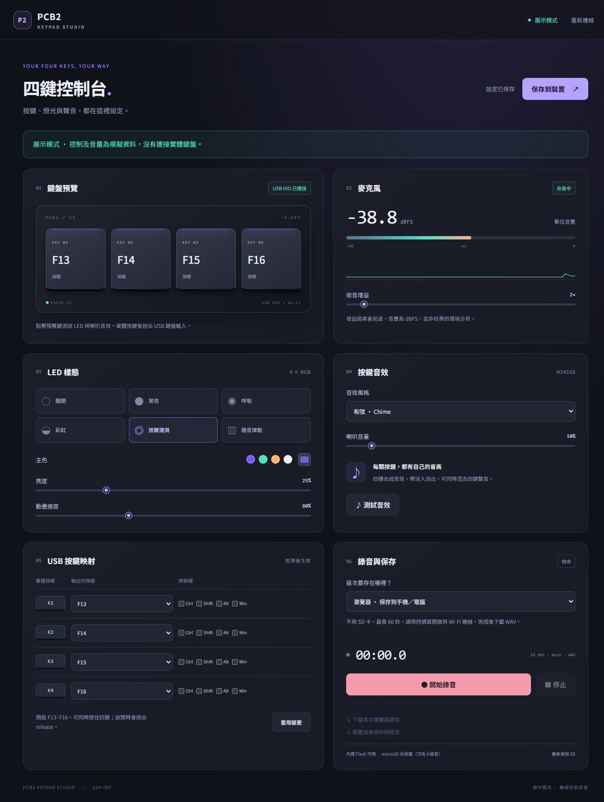

# KeyNest · 四鍵鍵盤工作台

針對 PCB2 製作的原生 ESP-IDF board library、四鍵 USB 鍵盤韌體與離線 Web App。

- 四顆可設定的 USB HID 按鍵，預設 F13–F16，支援修飾鍵與同時按住。
- 四顆 RGB LED，六種樣態，可調色、亮度與速度。
- NS4168 喇叭四種合成音效、自訂按鍵音與音量控制。可上傳音檔或使用最新錄音，裁切最多 2 秒，保存到內建 Flash 或 microSD。
- ZTS6672 麥克風即時音量、PCM 波形、直流偏移診斷、數位增益與 WAV 錄音；可選 ICS-43434 建置設定。
- Web App 由雲端網站提供，瀏覽器直接透過 USB 設定板子，日常不用本機背景工具；亦保留裝置 Wi-Fi 頁面。

公開的 [KeyNest 控制台](https://demo.terry878.org/keynest/) 以選鍵、設定動作、儲存為入口，燈光音效與收音錄音分頁操作。電腦版 Chrome／Edge 可直接連接 USB；普通快捷鍵支援按下擷取與常用預設。錄音與控制資料在瀏覽器與 PCB 之間傳送；詳見 [網頁 USB 控制台](web-console/README.md)。

GitHub 專案的網站連結與原 [GitHub Pages 網址](https://terry-eric.github.io/keynest/) 統一導向 Cloudflare 正式網址；Cloudflare 舊 `/pcb2/` 入口已移除。

v11 新增每鍵獨立的長按與雙擊，搭配「動作總表」直接指派。未啟用特殊按法的單鍵保留按住／放開，支援分開的 Ctrl 和 A。亦提供可編輯的連續動作範例，以及 Windows 開啟程式功能；詳見[KeyNest 操作說明](web-console/README.md#keynest單鍵動作總表與更多按法)。

v10 改為單一[雲端控制台](https://demo.terry878.org/keynest/)透過 USB 設定板子，不需安裝或啟動本機背景工具。快捷鍵、最多 16 鍵的組合、媒體鍵、英文文字和 16 步巨集由 ESP32-S3 自行執行，設定保存後可關閉網站。中文依系統輸入方式提供 Linux／macOS 選項；Windows 尚無適用所有軟體的免工具中文模式，詳見[文字輸入限制](firmware/keyboard/README.md#v10-免背景工具的文字與巨集)。每鍵音效、平滑混音與 10 分鐘錄音沿用 v9。

| 錄音目的地 | 預設上限 | 保存方式 |
|---|---:|---|
| 瀏覽器 | 10 分鐘 | 下載到手機／電腦 |
| 內建 Flash | 2.048 秒 | 保存最新一段，重開機後仍可下載 |
| microSD（選用） | 10 分鐘 | 建立新 WAV；需手動偵測卡片 |

實機已辨識 2 MB Quad PSRAM，音效與 Flash 錄音緩衝優先使用 PSRAM；沒有 PSRAM 時回退至內部 RAM。按鍵與效果設定保存到 NVS。所有錄音採用 16 kHz、mono、16-bit PCM WAV。

## 自訂按鍵音與免按 BOOT 更新

在 Web App 的「自訂按鍵音」選擇音檔，或按「使用最新錄音」。設定起點、長度（最多 2 秒）、是否調整音量及保存位置，再保存到裝置。先選第 1～4 顆鍵，每顆可保存自己的片段，也可更新未另設音效按鍵使用的共用音效。裁切後可先試聽，再保存到 Flash 或 SD；「恢復使用共用音效」只影響選中的鍵。四鍵可重疊播放，混音使用平滑音量限制避免直接截波。瀏覽器在本機解碼及裁切音檔；裝置保存 16 kHz mono PCM16。

「內建 Flash」提供斷電保存音效的功能；這塊板沒有獨立 EEPROM 音訊晶片。Flash 音效與 Flash 最新錄音分開保存。SD 音效建立 `KEY00001.WAV` 等新檔，不覆蓋舊檔；可在網頁列出及下載根目錄的 REC／KEY WAV。

新版支援網頁「進入下載模式」及 1200 baud USB touch，後續更新可免按 BOOT。首次更新不支援此功能的舊韌體，仍可能需要 BOOT。詳見 [燒錄與 USB 工具](firmware/keyboard/README.md)。

**SD 狀態：** 8 GB FAT32 卡曾通過錄音與重複下載，但目前同一實板仍會間歇讀成約 32 MB 或掛載失敗。SPI 暫時限制為 400 kHz，原因尚未確認；目前建議用 Flash 音效。程式不自動格式化卡片。麥克風人聲收音品質也仍待確認。

從 v9 更新到 v10 只寫入 `firmware.bin`（`0x10000`），分割表保持不變。從 v8 或更舊版本首次升到 v9／v10，仍需要同時寫入 `partitions.bin`（`0x8000`）及 `firmware.bin`（`0x10000`）。僅擴大最後的按鍵音區域；先備份，確認 `0x290000–0x390000` 沒有其他資料。原 NVS、Flash 錄音及共用音效位址與內容保留。詳見 [更新與驗證紀錄](firmware/keyboard/VALIDATION.md)。

## 使用

在 Windows／PowerShell 從 repository 根目錄執行：

```powershell
.\tools\build.ps1 -Keyboard
# 連接 PCB 並確認實際燒錄埠後：
.\tools\build.ps1 -Keyboard -Upload -Port COMx
```

建置使用 ESP-IDF 5.5.0，由 PlatformIO 呼叫；沒有 Arduino 相依。第一次會下載工具鏈。helper 適用目前含空白的 Windows 專案路徑，成功後輸出到 `firmware/artifacts/keyboard/`。

裝置開機後，連接 Wi-Fi `PCB2-Keypad-XXXX`（預設密碼 `pcb2play`），開啟 `http://192.168.4.1`。按「套用變更」生效，按「保存到裝置」才會在重開機後保留。

電腦要保持原本 Wi-Fi 時，燒錄新版後以 USB 連接 PCB，執行 `python tools/preview-keypad.py --usb --idle-timeout 3600`，開啟 `http://127.0.0.1:8028`。此方式支援真實音量、波形、增益與全部控制／錄音功能；需安裝 `pyserial`。舊版只輸出 USB 診斷日誌，必須更新韌體。

完整編譯、燒錄、USB、錄音與 API 說明見 [鍵盤應用文件](firmware/keyboard/README.md)。底層接腳與 component API 見 [board library 文件](firmware/README.md)。

## Web App 預覽

```powershell
python -m http.server 8027 --bind 127.0.0.1 --directory firmware/keyboard/main/web
```

開啟 `http://127.0.0.1:8027/?demo=1`。展示模式使用模擬資料，不會控制實體 PCB。

要在更新韌體前預覽真實麥克風，先連上 PCB Wi-Fi，再執行 `python tools/preview-keypad.py`，開啟 `http://127.0.0.1:8028`，按「開始即時監測」。本機相容預覽不保存音訊；停止後約 2 秒釋放暫存串流。詳細限制見鍵盤應用文件。



## 驗證與硬體依據

這塊板子的 Codex skill 位於 [skills/pcb2-esp32s3](skills/pcb2-esp32s3/SKILL.md)，整理接腳、USB／建置／更新流程與已知診斷限制，另提供唯讀產物校驗工具。將整個 `pcb2-esp32s3` 資料夾放到 Codex 的 skills 目錄後，可用 `$pcb2-esp32s3` 呼叫；skill 會從目前工作區定位專案，方便在其他電腦使用。

2026-10-13 已實際燒錄並驗證 USB 控制、即時波形及免 SD 的 WAV 串流。使用者確認麥克風為 ZTS6672；左聲道有資料、右聲道專用建置實測全零，與取得的規格書表格不一致，收音品質尚未通過。診斷與實機驗證狀態見 [驗證紀錄](firmware/keyboard/VALIDATION.md)。接腳依 2026-09-19 EasyEDA 保存快照。

- [硬體接腳證據](hardware/evidence/hardware-map.json)
- [已建置韌體](firmware/artifacts/keyboard/)及 [SHA-256 manifest](firmware/artifacts/keyboard/manifest.json)
- [測試與建置工具](tools/)

`firmware.bin` 是 app image，燒錄位址為 `0x10000`，不是可直接燒在 `0x0` 的合併映像。請使用 helper 的 `-Upload` 或 ESP-IDF `flash` 指令處理完整燒錄。
